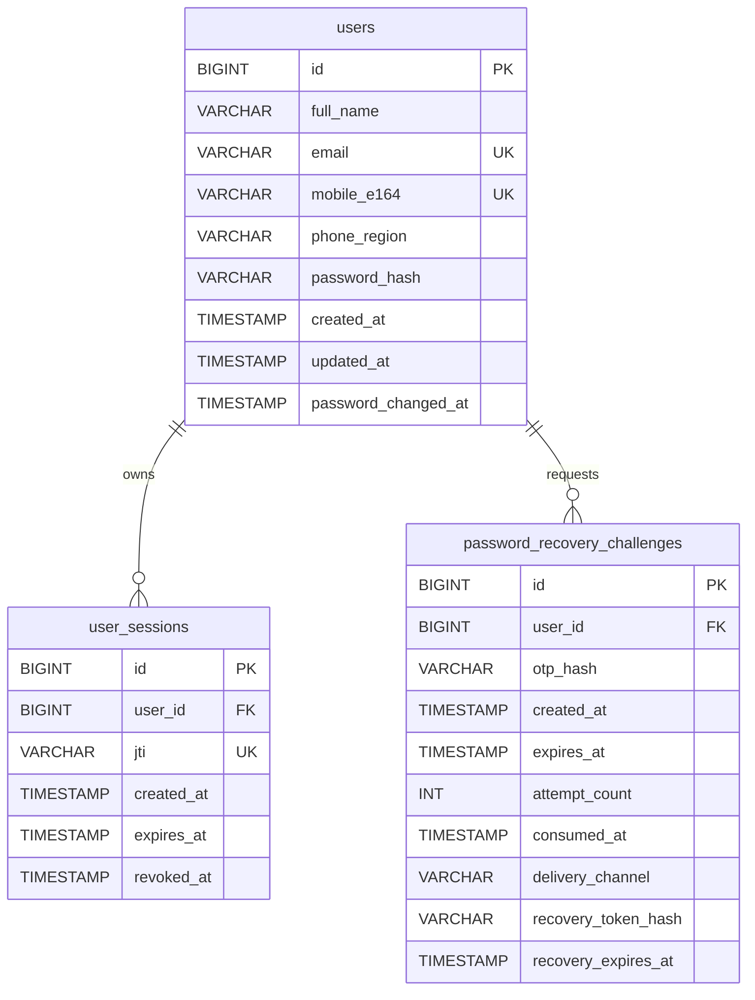

# Database schema

Flyway manages the schema in `src/main/resources/db/migration/V1__create_auth_schema.sql`. Hibernate validates the schema at startup. The database itself was not inspected during this implementation session, so do not run the migration against an existing database until its tables and data are reviewed.

## Table purposes

- `users` stores normalized unique email, canonical E.164 phone number, region, and BCrypt password hash.
- `user_sessions` stores each JWT session identifier (`jti`) and its expiry/revocation timestamps. Raw JWTs are not stored.
- `password_recovery_challenges` stores OTP and recovery-authorization hashes, expiry, attempt count, and one-time-use state. Raw OTPs are delivered only by the configured adapter and are never persisted.

Each child table references `users.id` with `ON DELETE CASCADE`. Unique indexes enforce email, phone, and JTI uniqueness. The migration creates tables only; provisioning database/users is a separate administrative action.
